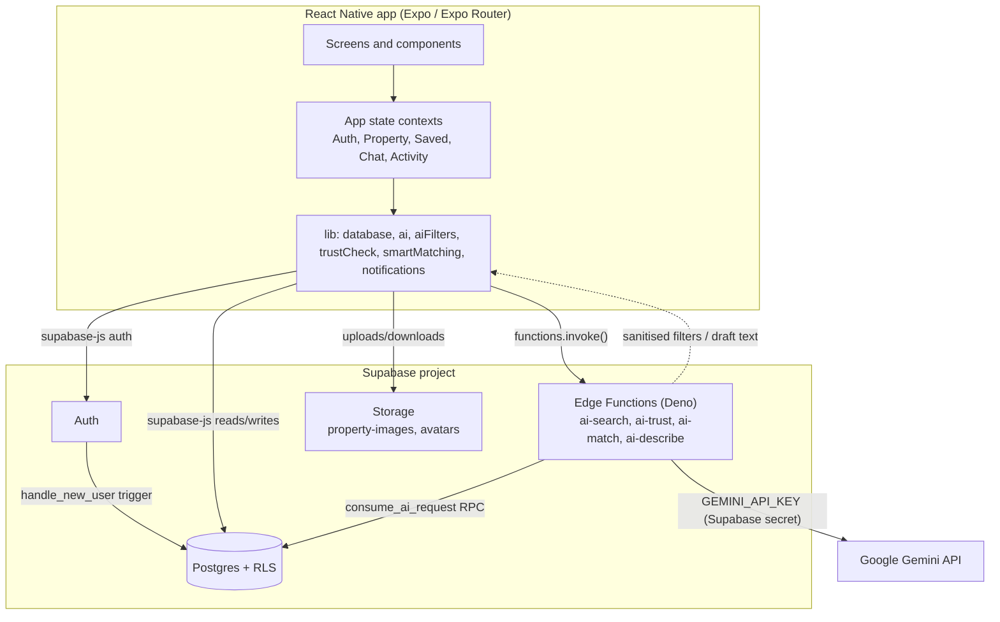
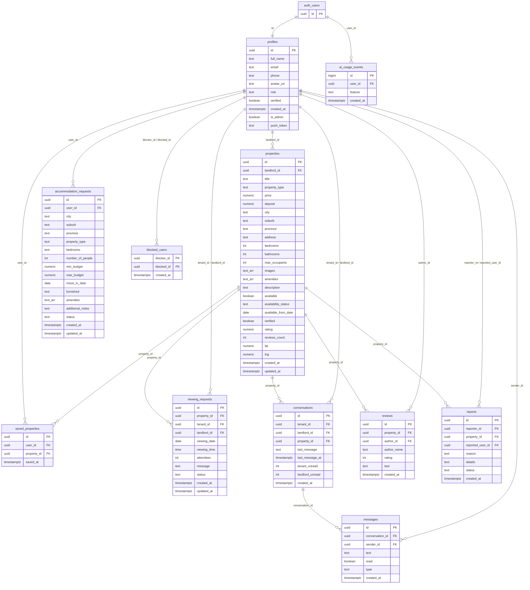

# Architecture

This document describes how ImbaFind is put together: the client app, the Supabase backend, and how AI calls reach Google Gemini. Everything here is derived from the repository; where a detail is not confirmed by the code or SQL migrations it is left out rather than guessed.

- App: Expo (React Native) with Expo Router and TypeScript, running on Android, iOS and web.
- Backend: Supabase — Postgres with Row Level Security (RLS), Auth, Storage and Deno Edge Functions.
- AI: Google Gemini, reached only through Supabase Edge Functions.

## High-level component and data flow

The app talks to Supabase with the public anonymous key using `supabase-js`. Reads and writes go to Postgres and are filtered by RLS; files go to the `property-images` and `avatars` storage buckets. AI requests go to an Edge Function with `supabase.functions.invoke()`, and the function — not the app — calls Gemini.

**The Gemini key is never in the client.** `GEMINI_API_KEY` lives only as a Supabase secret and is read inside the Edge Functions (`supabase/functions/_shared/gemini.ts`). The app never receives it and has no code path that can call Gemini directly. See [AI integration](AI_INTEGRATION.md) and [ADR 0001](adr/0001-ai-via-supabase-edge-functions.md).

## Client state contexts

Application state is split into focused React contexts. `context/AppContext.tsx` is a thin compatibility layer that re-exports a combined `useApp()` hook, so existing screens keep working, while new code imports the focused contexts directly.

| Context | Owns |
| --- | --- |
| `AuthContext` | Session and user, email/password and Google sign-in, sign-up, sign-out, password reset and role changes. |
| `PropertyContext` | Properties, filter state, the signed-in landlord's listings, and add/update/delete. Fetches from Supabase when credentials are present and falls back to built-in sample data otherwise. |
| `SavedContext` | The saved property IDs and the toggle to save or unsave. |
| `ChatContext` | Conversations, message lists, sending, opening and Realtime subscription to new messages. |
| `ActivityContext` | Viewing requests and accommodation requests, plus the currently selected property. |

`AppContext.tsx` also keeps a small role context (`userRole`, `isAdmin`, `userName`) that reads the user's profile so the sub-providers can receive the role. When Supabase is not configured, the app runs in a read-only mock mode.

## Edge Function boundary

All AI work is isolated in four Deno Edge Functions:

- `supabase/functions/ai-search` — turns a plain-English search into structured filters.
- `supabase/functions/ai-trust` — adds cautious description-quality warnings to the rule-based trust checks.
- `supabase/functions/ai-match` — phrases an explanation for the top-ranked request match.
- `supabase/functions/ai-describe` — drafts a listing description from the landlord's entered facts.

Shared behaviour lives in `supabase/functions/_shared/gemini.ts`: CORS handling, the `callGeminiJson` helper, PII stripping before text is sent, and `enforceAiRateLimit`. Every function requires a signed-in user and enforces the per-account AI limit by calling the `consume_ai_request` RPC. The functions return structured JSON, and the client validates it before use (for example `sanitizeAiFilters` in `lib/aiFilters.ts`). Details of the safeguards are in [AI integration](AI_INTEGRATION.md).

## Row Level Security model

RLS is enabled on the application tables, so authorisation is enforced in the database rather than only in the app.

- **Ownership by column.** Users read and manage their own rows: `profiles` by `id`, `saved_properties` and `accommodation_requests` by `user_id`, and `viewing_requests` by `tenant_id`. Landlords see viewings and read active requests for their side.
- **Listings.** Anyone may read available listings, and a landlord may read their own unavailable ones; only the owning landlord may insert, update or delete a property.
- **Conversations and messages.** Only the two participants (tenant and landlord) can access a conversation, and messages are readable only to participants of the parent conversation. Sending is routed through the `send_chat_message` security-definer RPC, which also enforces message length and blocked-user checks.
- **Reviews and reports.** Reviews are publicly readable and writable by their author. Reports are private: a user can insert and read only their own.
- **Privileged columns are protected.** `profiles.is_admin`, `profiles.verified` and `properties.verified` cannot be changed by ordinary users — column-level privileges are revoked and triggers reset them. Verification is an administrator action performed through the `admin_set_property_verified` and `admin_set_user_verified` RPCs, guarded by `is_imba_admin()`.
- **AI usage.** `ai_usage_events` has RLS enabled and all direct access revoked; it is touched only through the `consume_ai_request` security-definer RPC.

## Postgres schema

The diagram below is derived from `supabase/migrations/001_initial_schema.sql` and the later migrations. `text_arr` marks a `text[]` array column. `auth.users` is the Supabase-managed auth table.

Notes on the schema:

- `auth.users` — `profiles.id` references `auth.users.id` and is populated by the `handle_new_user` trigger on sign-up. `ai_usage_events.user_id` also references `auth.users.id`.
- `profiles` gained `push_token` (migration 004) and `is_admin` (migration 007) after the initial schema.
- `properties.images` and `properties.amenities`, and `accommodation_requests.amenities`, are `text[]` arrays (shown as `text_arr` above).
- `saved_properties` is unique on `(user_id, property_id)`; `reviews` is unique on `(property_id, author_id)`; and `conversations` has a null-distinct unique index on `(tenant_id, landlord_id, property_id)` so a property-less conversation cannot be duplicated.
- `conversations.property_id` and the two `reports` foreign keys use `on delete set null`; other foreign keys cascade on delete.
- RLS is enabled on every application table above; `ai_usage_events` has all direct access revoked and is used only through the `consume_ai_request` RPC.
